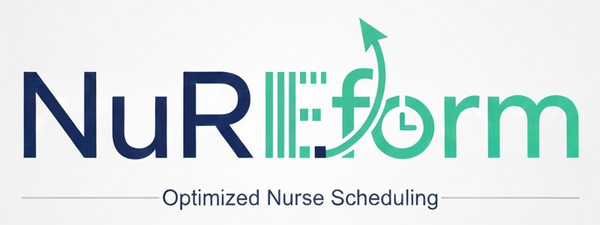
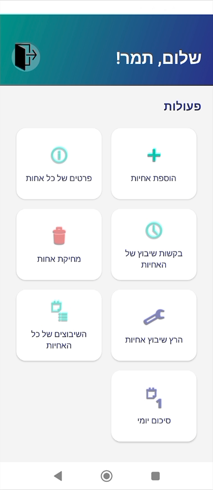
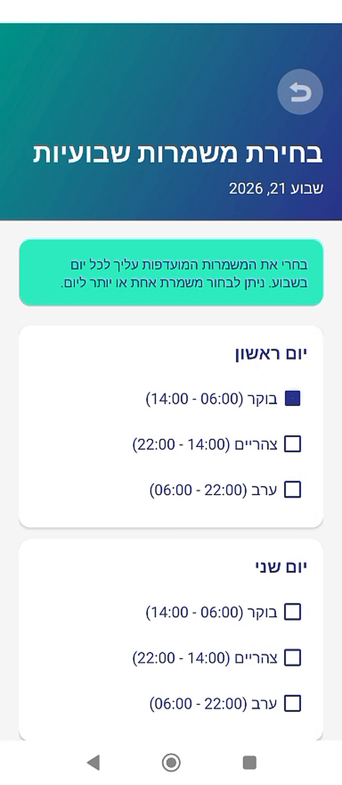
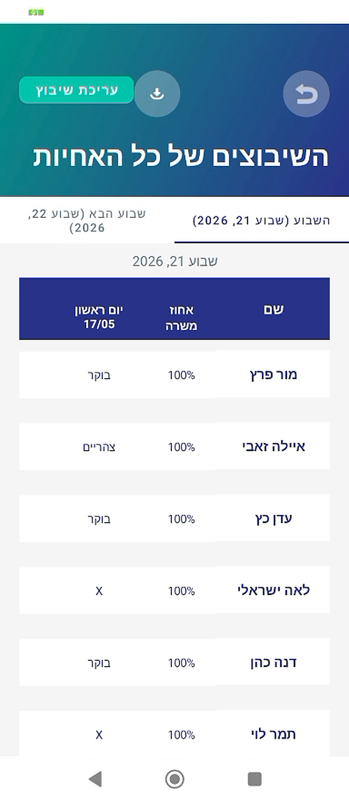
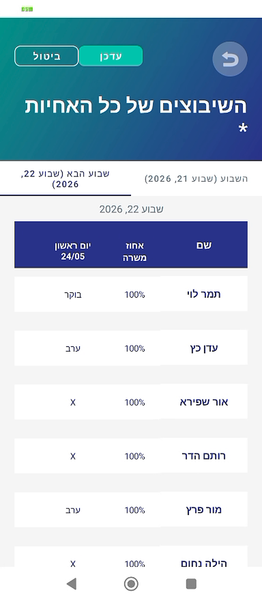
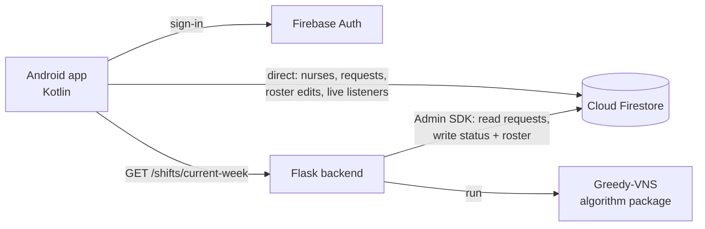
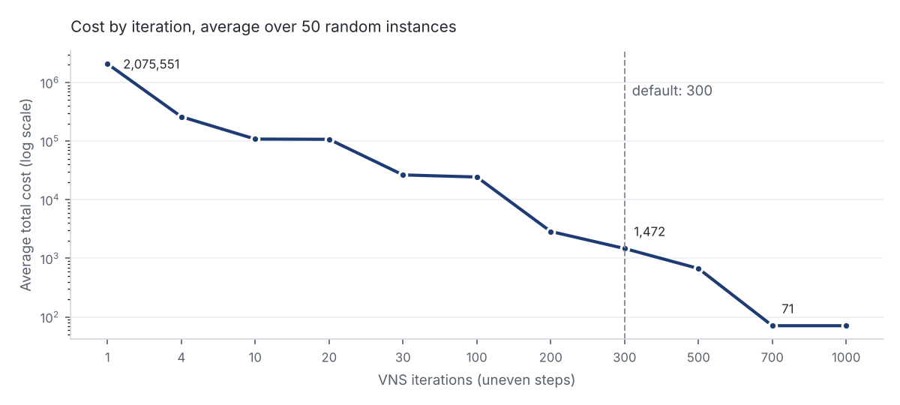

<div align="center">



# NuReform

**Nurses pick their shifts. The algorithm builds the week. The head nurse has the final say.**

A native Android app with a Python/Flask scheduling engine and Firebase, built around a Greedy + Variable Neighborhood Search (VNS) algorithm for the Nurse Scheduling Problem.


</div>

---

## Overview

NuReform is designed to replace the hand-built weekly roster of a hospital ward. Each nurse submits the shifts she can work next week, and the head nurse runs the scheduler. The algorithm aims for a full weekly roster that satisfies every hard rule (staffing minimums, rest time, contract caps) while keeping soft goals, like fairness and contract fulfillment, as close to target as possible. When the requests make that impossible, the result is marked as infeasible instead of being presented as valid. The head nurse reviews the roster, can change any cell by hand, and exports it as a PDF. The app UI is in Hebrew (right-to-left).

> **Status:** academic prototype, built as a final project. It has not been security-hardened or validated for clinical use, and it should not hold real staff data. See [Limitations](#limitations).

## Screenshots

<table>
  <tr>
    <td align="center"><br><sub>Head nurse home</sub></td>
    <td align="center"><br><sub>Nurse picks shifts</sub></td>
    <td align="center"><br><sub>Generated roster</sub></td>
    <td align="center"><br><sub>Manual edit mode</sub></td>
  </tr>
</table>

## How It Works

| # | Who | What happens |
|---|-----|--------------|
| 1 | Head nurse | Adds nurses: ID, contact details, job percentage and an initial password |
| 2 | Nurse | Picks the shifts she can work next week (at least 10 options), **by Tuesday** |
| 3 | Head nurse | Reviews all requests and runs the scheduler **on Wednesday** |
| 4 | Head nurse | Reviews the roster, edits cells if needed, exports a PDF |
| 5 | Everyone | Views her own schedule, the full roster and a daily summary |

| Shift | Hours | Minimum nurses |
|-------|-------|----------------|
| Morning | 06:00–14:00 | 5 |
| Afternoon | 14:00–22:00 | 4 |
| Evening | 22:00–06:00 | 3 |

## Key Features

**Head nurse**

- 👩‍⚕️ **Staff management:** add nurses (each gets her own login), view details, delete with a confirmation step
- 📋 **Requests:** every nurse's availability for next week in one grid
- ⚙️ **Auto-scheduling:** one tap runs the algorithm, with live progress
- ✏️ **Manual editing:** tap any cell to change a shift, then save or cancel

**Nurse**

- 🗓️ **Shift selection:** 7 days × 3 shifts, more than one option per day allowed
- 👤 **My schedule:** her own week, current and next

**Everyone**

- 📊 **Full roster and daily summary:** current and next week
- 📄 **PDF export:** right-to-left layout with dates in the header
- 📞 **Staff directory:** call or email a colleague in one tap

## Tech Stack

| | |
|---|---|
| **Android** | Kotlin, ViewModels + LiveData, coroutines, ViewBinding, Navigation Component, Koin, Retrofit / OkHttp |
| **Backend** | Python, Flask, Firebase Admin SDK |
| **Data & Auth** | Cloud Firestore, Firebase Authentication (email/password) |
| **Export** | Android `PdfDocument` (no external PDF library) |

## Architecture

The Android app works with **Firestore directly** for everyday data, and calls the **Flask backend** only to run the scheduler.



- **Direct to Firestore:** user profiles, nurse records, weekly requests, reading the roster, head-nurse edits.
- **Through the backend:** only the scheduling run. The backend reads every request for next week, runs the algorithm and writes the roster back.
- The app never waits on the HTTP call for the result. It listens to the roster document and updates when the status changes (see [Engineering Highlights](#engineering-highlights)).

## Scheduling Algorithm: Greedy + VNS

Nurse scheduling is a combinatorial problem: the number of possible rosters grows exponentially with the number of nurses, so exact methods don't scale. NuReform uses a hybrid approach. A **greedy builder** creates a starting roster, and **Variable Neighborhood Search** improves it by minimizing a single cost function.

### Constraints

**Hard** (the search treats them as top priority, and any that remain are reported):

| Rule | Detail |
|------|--------|
| Availability | A nurse is only assigned to a shift she asked for |
| Staffing minimum | 5 / 4 / 3 nurses for morning / afternoon / evening |
| One shift per day | Never two shifts on the same date |
| Weekly cap | 6 / 4 / 3 shifts for a 100% / 75% / 50% position |
| Rest | At least 12 hours between shifts (no evening followed by the next morning) |

**Soft** (minimized):

- **Contract:** each nurse is close to her weekly target (5 / 4 / 3 shifts)
- **Tier order:** a nurse with a higher position percentage should not get fewer shifts than one with a lower percentage
- **Fairness:** each nurse's morning / afternoon / evening mix is close to a target (3 / 2 / 1 for a full position)
- **Continuity:** a small bonus for consecutive shifts of the same type

### Cost function

```
Total = 500,000 × Σ (quota deficit)²
      +   5,000 × number of hard-rule violations
      + 120,000 × Σ (nurses above quota)²
      + soft cost
```

The deficit is **squared**: a shift missing two nurses costs four times as much as a shift missing one, so the search closes the biggest gaps first. Understaffing is counted twice on purpose, once as a deficit and once as a violation. Overstaffing is legal but heavily penalized, so the algorithm can't "solve" a week by piling extra nurses onto easy shifts. With these weights, any hard violation outweighs all soft costs combined.

### Search

1. **Greedy initialization** (`greedy_solution.py`). Fills the week slot by slot with **Lowest Availability First**: nurses who can cover the fewest slots are placed first, ties are broken by contract deficit and shift mix, and the pick is random among the top 3 to keep runs diverse. If the result breaks hard rules, it retries with the tightest slots first and then the easiest first, and keeps the best. The starting roster doesn't have to be fully legal: requiring that early led to dead ends, and VNS repairs the rest.
2. **VNS loop** (`vns.py`, `neighborhood.py`). Each iteration tries three neighborhoods in order and accepts a move only if it strictly lowers the cost:
    - **swap** (2-exchange): exchange the nurses of two assignments. Candidates are ordered by "stress" (understaffed slots, nurses below target, nurses with few available slots).
    - **reassign:** give one assignment to another available nurse.
    - **add:** fill a slot that is still below its minimum.
3. **Shake.** If none of the three improves, jump to a random neighbor among the 10 most stressed swaps, including swaps that break the rest rule, to escape a local minimum. If no swap neighbors exist at all, the run stops early.
4. The best roster seen so far is always kept. Optional **multi-start** reruns the whole process and picks the run with the fewest hard violations, then the lowest soft cost.

The scheduler runs **300 iterations** with a fixed seed, so the same requests always produce the same roster.

## Results

The algorithm was tested on **50 random instances** (9–19 nurses, 21 shift slots per week, random availability), with the iteration count ranging from 1 to 1,000:

| Iterations | Avg. total cost | Avg. soft cost |
|-----------:|----------------:|---------------:|
| 1 | 2,075,551 | 611 |
| 10 | 108,241 | 161 |
| 30 | 26,504 | 140 |
| 100 | 24,380 | 80 |
| 200 | 2,873 | 73 |
| **300** | **1,472** | **72** |
| 500 | 671 | 71 |
| 700 | 71 | 71 |

<p align="center"></p>

On **real availability data collected from nurses on a hospital ward**, one hard violation remains up to iteration 100. From iteration 200 every hard rule holds, and the final cost is **95**.

- **Easy inputs** (plenty of availability) converge within about 50 iterations.
- **Typical inputs** clear the hard rules in the first 100 iterations and fine-tune soft costs after that.
- **Tight inputs** (many unavailable nurses) rely on the shake step around 300 iterations.
- **Why 300:** past that point the gains on realistic inputs are marginal. On the hardest random instances a few violations can remain at 300 and clear by 700. That trade of runtime for rare cases is covered by the head nurse's manual edit.

**When no legal roster exists** (for example, too few nurses available on a weekend), no algorithm can satisfy every rule. NuReform detects this: it returns the roster with the fewest violations, saves it with `feasible: false` and its cost, and the head nurse closes the remaining gaps by hand.

## Engineering Highlights

### ⚡ Asynchronous scheduling with live status
`GET /shifts/current-week` returns immediately with `status: "running"` and runs the algorithm in a background thread. Progress lives in the Firestore document `nurses_shifts/{year_week}` (`running` → `success` / `error`), and the app listens to it in real time instead of polling. Triggering a week that is already running or already scheduled returns `409`.

### 🧩 The algorithm is a standalone package
`algorithm/` is pure Python with no Flask or Firebase imports. `app.py` only converts Firestore data into `Nurse` and `QuotaRequirement` objects and back. The same engine runs from the command line for a dry run on any week:

```bash
python app.py run 2026_17          # print the roster
python app.py run 2026_17 --save   # also write it to Firestore
```

### 🧑‍⚕️ Human in the loop
The algorithm does the heavy lifting. The head nurse makes the final call: edit mode lets her change any cell, and changes are saved only when she confirms. Real constraints that the model doesn't capture, such as a last-minute absence, stay in human hands.

### 🔐 Role-based access
Each user has a role (`NURSE` or `MANAGER`) in `users/{uid}`, and the home screen shows only that role's actions. The head nurse creates nurse accounts through a **secondary FirebaseAuth instance**, so adding a nurse doesn't sign her out.

### 📄 Native RTL PDF export
Rosters are drawn with Android's `PdfDocument`: names on the right, Saturday on the left, dates under each day, and a header with the week range and nurse count. No third-party library is needed.

## Data Model

```
users/{uid}                     uid, name, role (NURSE | MANAGER)
nurses/{uid}                    idNumber, name, phone, email, jobPercentage
 └─ weekly_shifts/{year_week}   shifts: { Sunday: ["morning", "noon"], ... }
nurses_shifts/{year_week}       status, feasible, totalObjective,
                                assignments: [{ nurseName, sunday … saturday }]
```

`year_week` is the ISO year and week, for example `2026_18`.

## Project Structure

```
├── backend/FlaskProject/
│   ├── app.py                 Flask endpoint, Firestore I/O, CLI mode
│   ├── algorithm/             Scheduling engine (pure Python)
│   │   ├── models.py          Nurse, QuotaRequirement, Assignment, Schedule
│   │   ├── constraints.py     Hard and soft constraints
│   │   ├── greedy_solution.py Initial roster
│   │   ├── neighborhood.py    swap / reassign / add moves
│   │   └── vns.py             VNS loop, shake, cost function
│   └── utilities/             User seeding script
└── android/NuReform/          Android app (Kotlin)
    └── app/src/main/java/com/example/nureform/
        ├── data/              Retrofit API, models, repositories
        ├── di/                Koin module
        └── ui/                One package per screen (ViewModel + state)
```

## Getting Started

**Backend**

```bash
cd backend/FlaskProject
pip install -r requirements.txt
python app.py        # starts Flask on port 3001
```

Create a Firebase project (Authentication + Firestore) and save a service-account key as `firebase_service_account.json` in `backend/FlaskProject/`. Never commit the key.

**Android**

1. Open `android/NuReform/` in Android Studio and add your own `google-services.json` to `app/`.
2. Set `BASE_URL` in `data/api/RetrofitClient.kt` to your backend: `http://10.0.2.2:3001/` for the emulator, or your computer's LAN IP for a physical phone.
3. Run the `app` configuration (minSdk 26).

## Limitations

NuReform is an academic prototype. These are the main gaps between it and a production system:

- **Hardcoded backend address:** set in `RetrofitClient.kt` and must be changed per environment.
- **No API authentication:** the scheduling endpoint is a `GET` that changes data, and it doesn't verify the caller's identity. It is only suitable for a trusted local network.
- **Infeasible results aren't surfaced:** the `feasible` flag is saved in Firestore, but the app doesn't yet show a warning when a roster breaks hard rules.
- **Deadline not enforced:** the Tuesday cutoff is disabled in the current build; the window is always open for testing.
- **Name-based roster:** the saved roster links shifts to nurses by name, not by ID.
- **Security rules not versioned:** Firestore rules live in the Firebase project, not in this repository, and have not been audited.
- **Scope:** one ward, nurses only.

## Future Work

- Token-verified API calls (Firebase ID token) and versioned, audited security rules
- A visible warning in the app when a roster is infeasible
- Cross-platform client (Flutter) for iOS and Android
- Several wards, with staff moving between them
- Other roles beyond nurses
- Shift swaps between nurses, checked against the hard rules automatically

---

<p align="center"><sub>Final project · B.Sc. Software Engineering, SCE · Tamar Mosheyev · Supervisor: Dr. Lior Aronshtam</sub></p>
